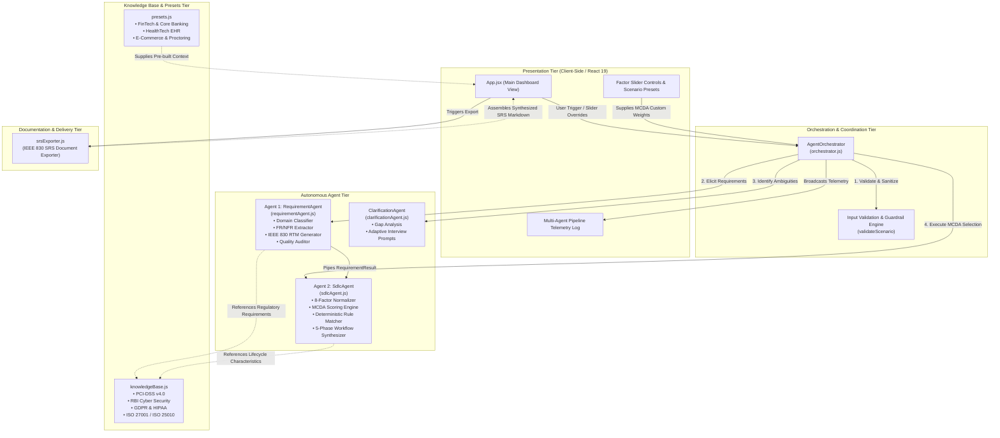
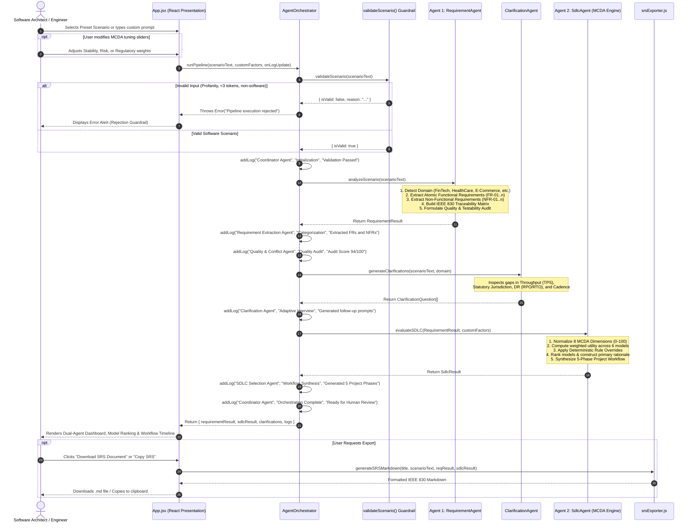
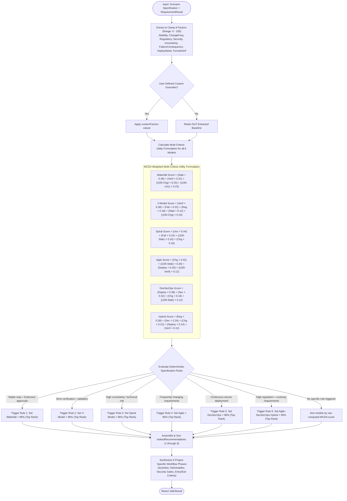

# System Architecture & UML Specification

**Project:** Dual-Agent AI System: Requirements & SDLC Identification  
**Architectural Baseline:** Multi-Agent Expert System / Decision Support Architecture  
**Standards Conformance:** IEEE 830 (SRS), ISO/IEC 25010 (Software Quality), Multi-Criteria Decision Analysis (MCDA)  
**Document Version:** 1.0.0  

---

## Table of Contents
1. [Executive Architectural Summary](#1-executive-architectural-summary)
2. [Architectural Principles & Design Patterns](#2-architectural-principles--design-patterns)
3. [System Component & Package Architecture (UML Component Diagram)](#3-system-component--package-architecture)
4. [Static Object Model (UML Class Diagram)](#4-static-object-model-uml-class-diagram)
5. [Dynamic Interaction & Pipeline Execution (UML Sequence Diagram)](#5-dynamic-interaction--pipeline-execution-uml-sequence-diagram)
6. [Decision Logic & MCDA Engine (UML Activity Diagram)](#6-decision-logic--mcda-engine-uml-activity-diagram)
7. [System Lifecycle & State Transitions (UML State Machine Diagram)](#7-system-lifecycle--state-transitions-uml-state-machine-diagram)
8. [Data Models & Data Dictionary](#8-data-models--data-dictionary)
9. [Verification, Validation & Quality Metrics](#9-verification-validation--quality-metrics)

---

## 1. Executive Architectural Summary

The **Dual-Agent AI Requirements & SDLC System** is a deterministic, rule-informed agentic application engineered to solve two fundamental software engineering lifecycle tasks:
1. **Task (i) — Software Requirements Elicitation & Analysis (Agent 1: `RequirementAgent`)**:
   Transforms raw, unstructured natural-language problem statements into structured, testable, and prioritized specifications. It produces atomic **Functional Requirements (FR)**, **Non-Functional Requirements (NFR)** mapped across critical quality attributes (Performance, Security, Reliability, Maintainability), an **IEEE 830 Traceability Matrix**, and an automated **Quality & Ambiguity Audit**.
2. **Task (ii) — Life Cycle Model Selection & Workflow Architecture (Agent 2: `SdlcAgent`)**:
   Applies **Multi-Criteria Decision Analysis (MCDA)** across 8 quantitative project dimensions to evaluate, score, and rank 6 candidate lifecycle models (*Waterfall, V-Model, Spiral Model, Agile (Scrum), DevSecOps, and Agile–DevSecOps Hybrid*). It enforces deterministic industry rules and synthesizes an actionable, 5-phase project execution roadmap with security checkpoints, compliance gates, deliverables, and role assignments.

Complementing these two core agents are:
- **`ClarificationAgent`**: Proactively detects unstated dimensions (e.g., peak TPS, disaster recovery tolerance, statutory jurisdictions) and constructs structured interview prompts.
- **`AgentOrchestrator`**: Coordinates pipeline synchronization, input validation guardrails, telemetry logging, and shared-state handoffs.
- **`srsExporter`**: Compiles multi-agent outputs into an IEEE 830 compliant markdown Software Requirements Specification (SRS).

---

## 2. Architectural Principles & Design Patterns

The architecture incorporates industry-standard software engineering patterns:

| Pattern / Principle | Application in System | Purpose |
|---|---|---|
| **Pipes and Filters / Pipeline** | `AgentOrchestrator.runPipeline()` | Linear execution pipeline where input validation feeds Agent 1, whose output feeds Clarification and Agent 2 sequentially. |
| **Strategy & MCDA Pattern** | `SdlcAgent._performMCDA()` | Decouples lifecycle scoring algorithms and weighting formulas from model definitions, enabling dynamic factor adjustment. |
| **Deterministic Rule Engine** | Specification rule matching in `SdlcAgent` | Guarantees reproducible, formal decisions for established engineering axioms (e.g. strict V&V requires V-Model; regulated evolving scope requires DevSecOps Hybrid). |
| **Fail-Fast Input Guardrail** | `validateScenario()` in `requirementAgent.js` | Rejects non-software prompts, vulgarity, and insufficient tokens before invoking downstream analysis engines (no default fallbacks). |
| **Traceability Matrix Pattern** | `traceabilityMatrix` generation | Maps each functional and non-functional requirement forward to verification stages and regulatory frameworks according to IEEE 830. |
| **Presenter / Single-Page Architecture** | `App.jsx` + React 19 + Tailwind CSS | High-speed, client-side rendering with real-time MCDA factor overrides and responsive SRS generation without server roundtrips. |

---

## 3. System Component & Package Architecture

The system is organized into distinct structural tiers, maintaining separation of concerns between user interaction, multi-agent orchestration, core elicitation and scoring engines, and regulatory knowledge bases.



---

## 4. Static Object Model (UML Class Diagram)

The class diagram below illustrates the system's object-oriented structure, class attributes, method signatures, data entities, and inter-class associations.

```mermaid
classDiagram
    direction TB

    class AgentOrchestrator {
        +RequirementAgent requirementAgent
        +SdlcAgent sdlcAgent
        +ClarificationAgent clarificationAgent
        +runPipeline(scenarioText: string, customFactors: object, onLogUpdate: function) Promise~PipelineResult~
    }

    class RequirementAgent {
        +string name
        +identifyRequirements(scenario: string) RequirementResult
        +analyzeScenario(scenario: string) Promise~RequirementResult~
    }

    class SdlcAgent {
        +string name
        +evaluateSDLC(arg1: any, arg2: any, arg3: any) SdlcResult
        +identifySDLC(arg1: any, arg2: any, arg3: any) SdlcResult
        -_processSDLC(scenario: string, reqData: RequirementResult, factors: object) SdlcResult
        -_extractFactors(text: string, reqData: RequirementResult, factors: object) MCDAFactors
        -_performMCDA(text: string, reqData: RequirementResult, factors: MCDAFactors) RankedModel[]
        -_generateWorkflowPhases(modelName: string, factors: MCDAFactors) WorkflowPhase[]
    }

    class ClarificationAgent {
        +string name
        +generateClarifications(scenarioText: string, domain: string) ClarificationQuestion[]
    }

    class InputValidator {
        <<utility>>
        +validateScenario(scenario: string) ValidationResult
    }

    class SRSExporter {
        <<utility>>
        +generateSRSMarkdown(title: string, scenarioText: string, reqResult: RequirementResult, sdlcResult: SdlcResult) string
    }

    class RequirementResult {
        +string scenario
        +string domain
        +FunctionalRequirement[] functionalRequirements
        +NonFunctionalRequirement[] nonFunctionalRequirements
        +number totalCount
        +Metrics metrics
        +QualityReport qualityReport
        +TraceabilityItem[] traceabilityMatrix
    }

    class FunctionalRequirement {
        +string id
        +string title
        +string category
        +string priority
        +string riskLevel
        +string sourceStakeholder
        +string statement
        +string userStory
        +string[] acceptanceCriteria
        +string businessJustification
        +string[] applicableRegulations
    }

    class NonFunctionalRequirement {
        +string id
        +string title
        +string category
        +string priority
        +string statement
        +string targetMetrics
        +string[] applicableRegulations
    }

    class SdlcResult {
        +string recommendedModel
        +number suitabilityScore
        +string justification
        +RankedModel primaryModel
        +RankedModel[] rankedRecommendations
        +MCDAFactors evaluatedFactors
        +KeyPhase[] keyPhases
        +WorkflowPhase[] projectWorkflow
        +AlternativeModel[] alternatives
    }

    class MCDAFactors {
        +number requirementStability
        +number changeFrequency
        +number regulatoryCriticality
        +number securityRisk
        +number technicalUncertainty
        +number failureConsequence
        +number continuousDeploymentNeed
        +number formalVerificationNeed
    }

    class WorkflowPhase {
        +number phaseNumber
        +string phaseName
        +string durationEstimate
        +string objective
        +string[] responsibleRoles
        +string[] activities
        +string[] deliverables
        +string[] securityControls
        +string complianceCheckpoints
        +string entryCriteria
        +string exitCriteria
    }

    class QualityReport {
        +number overallScore
        +string status
        +string testabilityRating
        +Ambiguity[] ambiguities
    }

    %% Associations and Dependencies
    AgentOrchestrator *-- RequirementAgent : contains
    AgentOrchestrator *-- SdlcAgent : contains
    AgentOrchestrator *-- ClarificationAgent : contains
    AgentOrchestrator ..> InputValidator : calls
    RequirementAgent ..> InputValidator : calls
    SdlcAgent ..> InputValidator : calls

    RequirementAgent ..> RequirementResult : produces
    RequirementResult *-- FunctionalRequirement : aggregates
    RequirementResult *-- NonFunctionalRequirement : aggregates
    RequirementResult *-- QualityReport : includes

    SdlcAgent ..> SdlcResult : produces
    SdlcResult *-- MCDAFactors : contains
    SdlcResult *-- WorkflowPhase : contains
    SdlcAgent ..> RequirementResult : consumes

    AgentOrchestrator ..> SRSExporter : utilizes
```



---

## 5. Dynamic Interaction & Pipeline Execution (UML Sequence Diagram)

The sequence diagram details the end-to-end runtime lifecycle: user interaction, multi-agent coordination, intermediate validation checks, and document generation.



---

## 6. Decision Logic & MCDA Engine (UML Activity Diagram)

The activity diagram depicts the internal decision-making process of **Agent 2 (`SdlcAgent`)**, showing how quantitative factors and deterministic specification rules resolve into the optimal SDLC model.



---

## 7. System Lifecycle & State Transitions (UML State Machine Diagram)

The state machine outlines the lifecycle of a scenario analysis within the application runtime.

```mermaid
stateDiagram-v2
    [*] --> Idle : Application Initialized

    Idle --> ValidatingInput : User selects preset or clicks 'Run Analysis'
    
    state ValidatingInput {
        [*] --> SanitizingInput
        SanitizingInput --> ProfanityCheck
        ProfanityCheck --> TokenCountCheck
        TokenCountCheck --> DomainKeywordCheck
        DomainKeywordCheck --> [*]
    }

    ValidatingInput --> Rejected : Validation Failed (Profanity / Non-Software / Too Brief)
    Rejected --> Idle : Error displayed on UI; await corrected input

    ValidatingInput --> RequirementsElicitation : Validation Passed

    state RequirementsElicitation {
        [*] --> ClassifyDomain
        ClassifyDomain --> ExtractFunctionalReqs
        ExtractFunctionalReqs --> ExtractNonFunctionalReqs
        ExtractNonFunctionalReqs --> GenerateTraceabilityMatrix
        GenerateTraceabilityMatrix --> AuditQualityAndAmbiguity
        AuditQualityAndAmbiguity --> [*]
    }

    RequirementsElicitation --> ClarificationInterview : RequirementResult Generated

    state ClarificationInterview {
        [*] --> InspectThroughputGap
        InspectThroughputGap --> InspectRegulatoryGap
        InspectRegulatoryGap --> InspectDRGap
        InspectDRGap --> InspectCadenceGap
        InspectCadenceGap --> [*]
    }

    ClarificationInterview --> SDLCAnalysis : Gaps Identified

    state SDLCAnalysis {
        [*] --> FactorExtraction
        FactorExtraction --> MCDAUtilityComputation
        MCDAUtilityComputation --> DeterministicRuleOverride
        DeterministicRuleOverride --> ModelRanking
        ModelRanking --> WorkflowPhaseSynthesis
        WorkflowPhaseSynthesis --> [*]
    }

    SDLCAnalysis --> SynthesisComplete : SdlcResult Formulated
    
    SynthesisComplete --> Idle : Modify Input or Switch Preset
    SynthesisComplete --> ExportingSRS : User triggers 'Download SRS' or 'Copy SRS'
    
    ExportingSRS --> SynthesisComplete : Markdown File Streamed / Copied
```



---

## 8. Data Models & Data Dictionary

### 8.1 Functional Requirement (`FR`) Data Schema
Each functional requirement generated by Agent 1 follows this schema:
```typescript
interface FunctionalRequirement {
  id: string;                      // e.g. "FR-01", "FR-02"
  title: string;                   // Concise functional name
  category: string;                // e.g. "Authentication", "Core Processing"
  priority: "High" | "Medium" | "Low";
  riskLevel: "Critical" | "High" | "Medium" | "Low";
  sourceStakeholder: string;       // Originating stakeholder persona
  statement: string;               // Formal IEEE 830 requirement statement
  userStory: string;               // Agile user story format: "As a... I want... So that..."
  acceptanceCriteria: string[];    // Verifiable Gherkin/acceptance bullet points
  businessJustification: string;   // Economic or strategic rationale
  applicableRegulations: string[]; // e.g. ["PCI-DSS Req 8.3", "RBI 2FA Mandate"]
}
```

### 8.2 Non-Functional Requirement (`NFR`) Data Schema
```typescript
interface NonFunctionalRequirement {
  id: string;                      // e.g. "NFR-01", "NFR-02"
  title: string;                   // e.g. "Data Encryption & Key Management"
  category: "Security" | "Performance" | "Availability" | "Auditability" | "Maintainability";
  priority: "Critical" | "High" | "Medium";
  statement: string;               // Formal constraint specification
  targetMetrics: string;           // Quantifiable target (e.g. "P99 < 800ms; 99.99% uptime")
  applicableRegulations: string[]; // e.g. ["PCI-DSS", "ISO 27001"]
}
```

### 8.3 The 8 MCDA Project Dimensions
Agent 2 scores project suitability across 8 normalized dimensions (0 to 100):
1. **`requirementStability`**: Extent to which requirements are fully specified and static versus evolving.
2. **`changeFrequency`**: Anticipated frequency of scope adjustments, sprint iterations, or feature pivots.
3. **`regulatoryCriticality`**: Degree of statutory governance (PCI-DSS, RBI, HIPAA, GDPR, FDA).
4. **`securityRisk`**: Exposure to financial transactions, sensitive PII/PHI, or external threats.
5. **`technicalUncertainty`**: Degree of novel research, unproven third-party algorithms, or hardware risk.
6. **`failureConsequence`**: Severity of system failure (loss of life, critical financial loss, reputational catastrophe).
7. **`continuousDeploymentNeed`**: Urgency of canary releases, automated CI/CD pipelines, and fast time-to-market.
8. **`formalVerificationNeed`**: Requirement for mathematical proof, bilateral V&V, and exhaustive audit traceability.

### 8.4 Candidate SDLC Models Evaluated
1. **Waterfall**: Linear-sequential life cycle with strict phase gate sign-offs.
2. **V-Model**: Bilateral verification and validation lifecycle with direct phase-to-testing tier mapping.
3. **Spiral Model**: Risk-driven iterative lifecycle focusing on repeated prototyping and risk mitigation loops.
4. **Agile (Scrum)**: Iterative, sprint-based delivery maximizing responsiveness to changing product backlogs.
5. **DevSecOps**: Automated CI/CD pipeline model embedding security-as-code and continuous deployment gates.
6. **Agile–DevSecOps Hybrid**: Balanced enterprise model combining iterative sprint agility with formal continuous compliance and security gates.

---

## 9. Verification, Validation & Quality Metrics

The system enforces automated verification via `test_agents.mjs`:
- **Deterministic Specification Tests**: Validates that standard industry scenarios trigger expected models with 100% precision.
- **Fail-Fast Rejection Tests**: Ensures that vulgar inputs, non-software sentences, and trivial strings are formally rejected by both agents without fallback to Agile.
- **IEEE 830 Conformance Check**: Confirms that generated SRS files include complete requirement breakdowns, MCDA rankings, RTM matrices, and executive sign-off blocks.

