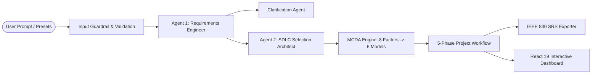

# Dual-Agent AI System: Requirements & SDLC Identification

A focused, lightweight Agentic-AI application with two dedicated agents strictly designed for:
1. **Task (i)**: Identify and list software requirements (Functional & Non-Functional) for a given scenario, functionality, or module.
2. **Task (ii)**: Identify a suitable SDLC for the above specification, complete with justification, phases, and alternative comparisons.

---

## 🤖 The Two Agents

### **Agent 1: Requirements Engineer**
- **Role**: Analyzes the input scenario, module, or functionality.
- **Output**:
  - **Functional Requirements (FR)**: Atomic, testable requirements with IDs (`FR-01`, `FR-02`), descriptive titles, detailed behavioral specifications, and priority levels.
  - **Non-Functional Requirements (NFR)**: Technical constraints across Security, Performance, Scalability, Availability, and Regulatory/Privacy Compliance.

### **Agent 2: SDLC Selection Architect**
- **Role**: Evaluates the specification produced by Agent 1 against engineering trade-offs, security demands, and delivery cadence.
- **Output**:
  - **Recommended SDLC Model** (e.g. *DevSecOps Hybrid*, *Agile (Scrum)*, *Spiral Model*, *V-Model*).
  - **Suitability Score & Rationale**: Direct explanation of why this SDLC fits the identified requirements.
  - **Proposed SDLC Phases**: Stepped timeline from inception to release.
  - **Alternative Models Comparison**: Trade-off notes on other SDLC paradigms.

---

## 🏗️ Architecture & UML Overview

The system is architected as an **Agentic Pipes-and-Filters Expert System** featuring multi-agent collaboration, deterministic input guardrails, Multi-Criteria Decision Analysis (MCDA), and IEEE 830 compliant SRS export.



Detailed architectural specifications and complete UML diagrams are available in:
👉 **[Full Architecture & UML Specification (ARCHITECTURE.md)](ARCHITECTURE.md)**

- **UML Component Diagram**: System layers, modules, knowledge bases, and dependencies
- **UML Class Diagram**: Object model, class relationships, methods, and attributes
- **UML Sequence Diagram**: Dynamic step-by-step pipeline execution flow
- **UML Activity Diagram**: Multi-Criteria Decision Analysis (MCDA) scoring logic and deterministic rule matching
- **UML State Machine Diagram**: Pipeline execution lifecycle and states

---

## 🚀 Running the App

### Start Web Application
```bash
npm run dev
```
Open **`http://127.0.0.1:5173/`** in your browser.

### Run Verification Test Suite
```bash
node test_agents.mjs
```
